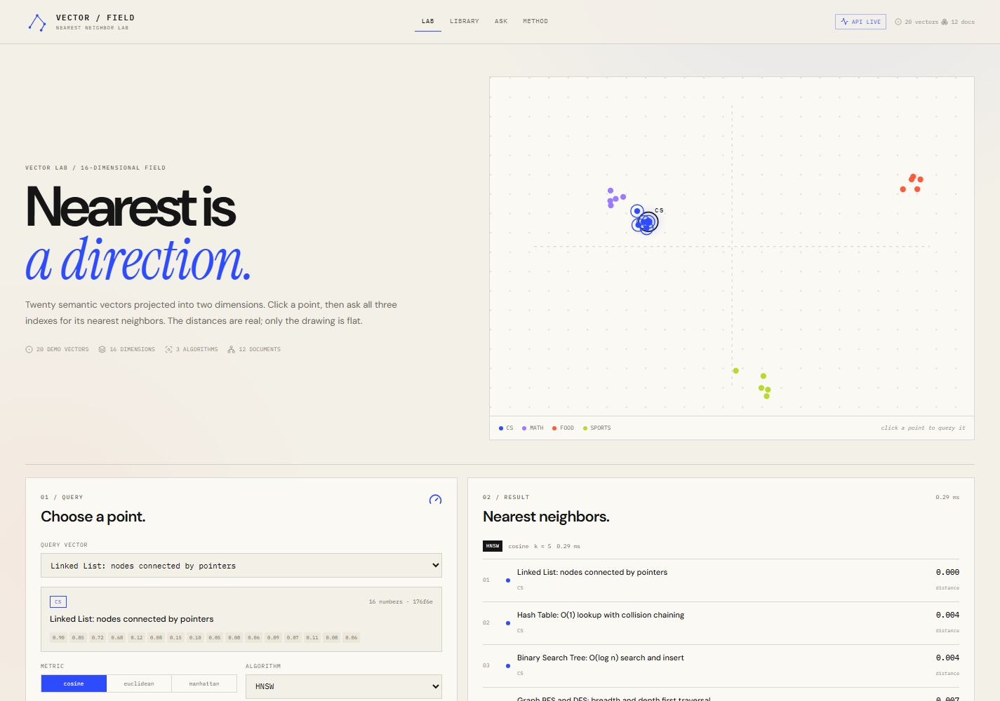
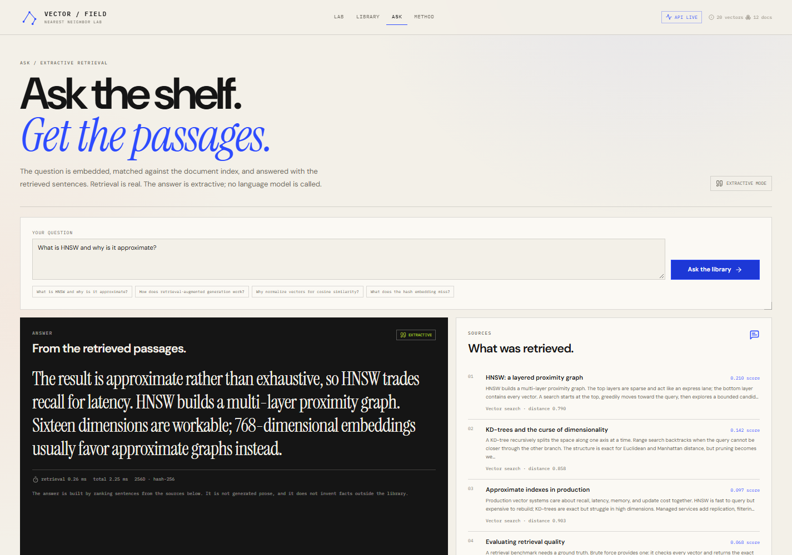

# VectorSearch

> HNSW, KD-tree, and RAG, measured against brute force.

[](https://vectorsearch.furqankhan.dev)
[](https://furqankhan.dev)
[](LICENSE)

VectorSearch is a browser lab for nearest-neighbour search and retrieval. It compares HNSW, a KD-tree, and brute force on the same twenty 16-dimensional vectors, projects the field into two dimensions with PCA, measures latency and recall against brute force, and runs an extractive RAG pipeline over a MongoDB passage library using deterministic hash-256 embeddings. It is for developers who want to see the trade-offs instead of a single benchmark line.

Part of [Furqan Khan's portfolio](https://furqankhan.dev).

**Live:** https://vectorsearch.furqankhan.dev · **Source:** https://github.com/fk219/vector-search · **Case study:** https://furqankhan.dev

## What it is

The app has four screens. The Lab shows the projected vector field and runs a query through one of the three indexes. The Library lists the seeded passages and lets you add or delete a passage. Ask embeds a question, retrieves passages, and builds an answer from their sentences. Method explains the indexes, metrics, and API. This is a MERN rebuild of an earlier C++ vector database; the original implementation remains in `engine/`.

The API owns the indexes and the data. It keeps HNSW and KD-tree instances for each distance metric, brute force as the ground-truth baseline, and one HNSW cosine index for the document library. Every search, benchmark, and retrieval number in the UI comes from the running API; no model is downloaded and no language model is called.

| Vector lab | Extractive answer |
|---|---|
|  |  |

## The signature idea

The comparison is the product. All three indexes answer the same query over the same vectors, under the same metric, and the benchmark uses every demo vector as a query. Recall is measured against brute force at the selected `k`, so HNSW's approximation is reported rather than hidden.

The retrieval side applies the same rule. The document index uses a deterministic hash-256 embedding of tokens and bigrams, not a semantic transformer. The answer is built by ranking retrieved sentences against the question's tokens and citing the passages it used. The trade-off is deliberate: lexical retrieval is weaker on paraphrase, but every step can be inspected.

## What works

- **20 demo vectors / 16D.** Five each across CS, math, food, and sports, projected to 2D with PCA for the scatter plot.
- **Three search structures.** HNSW (a layered proximity graph), a KD-tree (axis-aligned splits with backtracking), and brute force.
- **Three metrics.** Cosine, Euclidean, and Manhattan.
- **A real benchmark.** Every demo vector is used as a query. Latency and recall are measured against brute force at the selected `k`.
- **MongoDB document library.** Twelve seeded passages, each with a 256-dimensional hash embedding. Add or delete a passage and the document index rebuilds.
- **Extractive RAG.** A question is embedded, matched against the document index, and answered by ranking the retrieved sentences. Retrieval, citations, and timings are real; no language model is called.
- **Honest labelling.** The interface and the API identify the embedding as `hash-256`. HNSW is labelled approximate, and the KD-tree is exact for Euclidean distance while the benchmark reports measured recall for every metric.
- **Operational surface.** OpenAPI 3.1, request IDs, structured request logs, and separate limits for search, expensive work, and document writes.

## Tech stack in detail

| Layer | Technology | What it does here |
|---|---|---|
| Frontend | React 18, Vite 5, React Router 6 | Lab, library, ask, and method screens |
| UI | Custom CSS, lucide-react | Vector field, rankings, controls, and icons |
| Indexes | Custom JavaScript HNSW, KD-tree, brute force | Approximate, tree-based, and exact nearest-neighbour search |
| Metrics | Cosine, Euclidean, Manhattan | Distance functions shared by search, benchmark, and retrieval |
| Projection | PCA via power iteration | Turns the 16D field into the 2D scatter plot |
| Embeddings | Deterministic `hash-256` | Token and bigram features for the document library and questions |
| API | Express 4 | REST surface under `/api`, validation, and error handling |
| Persistence | MongoDB, Mongoose 8 | Demo vectors, documents, and startup seeding |
| Safety and limits | Zod 4, Helmet, express-rate-limit | Schema checks, headers, rate limits, and the demo operator gate |
| Testing and delivery | Vitest, Supertest, mongodb-memory-server, Render, Vercel, GitHub Actions | Algorithm/API tests and the deployed split |

## Architecture

`index.js` connects to MongoDB, seeds the demo field and the twelve passages, and rebuilds the singleton search engine before Express starts. `SearchEngine.rebuild` loads the demo vectors and documents, builds HNSW and KD-tree instances for each metric, and builds the document HNSW index. The routes call that engine; the React app only renders its responses.

```text
MongoDB
  |-- 20 demo vectors --> HNSW + KD-tree per metric, brute force baseline
  |-- 12 documents ----> hash-256 embeddings --> document HNSW (cosine)
                                  |
POST /api/search ----------------> selected index --> ranked neighbours
POST /api/benchmark -------------> all 20 vectors as queries --> latency + recall
POST /api/ask -------------------> embed question --> retrieve passages
                                                   --> rank sentences
                                                   --> cited extractive answer
```

```text
web/                         React + Vite lab
  src/
    pages/                   Lab.jsx, Library.jsx, Ask.jsx, Method.jsx
    components/              VectorField.jsx
    useVectorLab.js          API state and actions
    api.js                   Fetch wrapper with retries and the demo operator header

api/                         Express + MongoDB API
  src/
    algorithms/              hnsw.js, kdtree.js, brute.js
    embedding.js             Deterministic hash-256 embeddings
    metrics.js               Cosine, Euclidean, Manhattan
    projection.js            PCA projection for the scatter plot
    searchEngine.js          Index lifecycle, search, benchmark, RAG
    engine.js                Shared SearchEngine instance
    data.js                  Demo vectors and 12 seed passages
    seed.js                  Startup seeding
    models.js                DemoVector and Document schemas
    routes.js                REST surface
    security.js              Rate limits and operator gate
    openapi.js               OpenAPI 3.1 contract
  test/                      Algorithm and API tests

engine/                      Original C++ vector database and web UI
docs/                        Screenshots
```

## Run it locally

Prerequisites: Node 20 or 22 and npm, plus a MongoDB instance or an Atlas connection string. CI and the `Dockerfile` use Node 20; `.nvmrc` and the Render config use Node 22.

```bash
npm run install:all

# Create api/.env from api/.env.example, then review the connection settings.

# API on http://localhost:4300
npm run dev:api

# Web on http://localhost:5177, proxying /api to port 4300
npm run dev:web
```

Create `api/.env` from `api/.env.example`. The web app reads its optional settings from `web/.env`; without `VITE_API_URL`, Vite proxies `/api` to the local API.

| Name | Required | Purpose |
|---|---|---|
| `MONGODB_URI` | No | MongoDB connection string. Development falls back to a local database; set this to Atlas in production. |
| `PORT` | No | API port. Defaults to `4300`. |
| `CORS_ORIGIN` | No | Comma-separated allowed origins. An empty value allows all origins. |
| `ADMIN_TOKEN` | No | Overrides the demo token used for document mutations; set it in production. |
| `NODE_ENV` | No | Runtime mode used by the server. |
| `VITE_API_URL` | No | Web API base URL. Empty uses the Vite proxy or same-origin `/api`. |
| `VITE_DEMO_ADMIN_TOKEN` | No | Token the web app sends for writes. It must match `ADMIN_TOKEN`. |

**Demo access:** there is no login. The demo vectors and document library are seeded on startup. Search, benchmark, and ask work immediately; document add/delete uses the demo operator gate.

## API

| Method | Path | Purpose |
|---|---|---|
| `GET` | `/api/health` | Health check with MongoDB readiness |
| `GET` | `/api/openapi.json` | OpenAPI 3.1 contract |
| `GET` | `/api/stats` | Index, vector, and embedding statistics |
| `GET` | `/api/demo` | 20 demo vectors with their 2D projection |
| `POST` | `/api/search` | Query HNSW, KD-tree, or brute force |
| `POST` | `/api/benchmark` | Latency and recall comparison across the indexes |
| `GET` | `/api/documents` | Document library without embeddings |
| `POST` | `/api/documents` | Embed and index a passage (operator token) |
| `DELETE` | `/api/documents/:id` | Remove a passage and rebuild the index (operator token) |
| `POST` | `/api/ask` | Retrieve passages and build an extractive answer |

The operator gate uses the `x-demo-admin-token` header. It is a demo control, not production authentication. Search, benchmark, and ask are public and rate-limited.

## Tests

```bash
npm test
```

The root command runs the API suite through Vitest: four algorithm tests and seven API tests. They cover hash embeddings, KD-tree and HNSW recall, PCA projection, the demo field, all three search algorithms, benchmarking, MongoDB readiness, operator-token gating and payload validation, document add/delete, extractive answers, and invalid input. API tests use `mongodb-memory-server`, so they do not need a local MongoDB.

## Deployment

- **Frontend:** Vercel serves the Vite build from `web/`. `web/vercel.json` rewrites `/api/*` to the Render API and falls back to `index.html` for client-side routes.
- **API:** Render deploys the `api/` service from `render.yaml` on Node 22, region Singapore, free plan. The health check is `/api/health`, the build is `npm install --omit=dev`, and the start command is `npm start`. The deployed health endpoint is https://vector-search-api-je4n.onrender.com/api/health.
- **Database:** MongoDB Atlas in the live deployment. Set `MONGODB_URI` and `CORS_ORIGIN` in Render.
- **Container:** `api/Dockerfile` is a Node 20 Alpine image that exposes port 4300 and runs `node src/index.js`.
- **CI:** GitHub Actions runs API tests and the web build on pushes to `main` or `master` and on pull requests, using Node 20.

## Limits and notes

- The live embedding is a deterministic hash of tokens and bigrams. It captures lexical overlap, not deep semantics.
- The 16D demo vectors are hand-authored for clustering; they are not learned embeddings.
- HNSW is approximate. The benchmark reports its recall instead of hiding it.
- The KD-tree is exact for Euclidean distance. For cosine, the index normalizes vectors and searches that space; the algorithm test requires more than 0.98 recall rather than perfect exactness.
- The document index lives in one Node process and is rebuilt from MongoDB after changes. It is not persisted as a graph.
- There is no authentication. This is a public lab with a demo operator gate.
- No language model is called. The answer is extractive and cites the passages it used.
- Production use would need persisted indexes, replication, filtered search, and real authentication.
- The free Render API can cold-start after inactivity, so the first request may be slow.

## Credits and my contribution

- Original C++ vector database: `perryvegehan`, preserved in `engine/` for reference.
- The MERN rebuild, HNSW and KD-tree implementations, PCA projection, retrieval pipeline, React lab, tests, Dockerfile, and deployment are the work presented in this repository.

## License

MIT. See [LICENSE](LICENSE).
